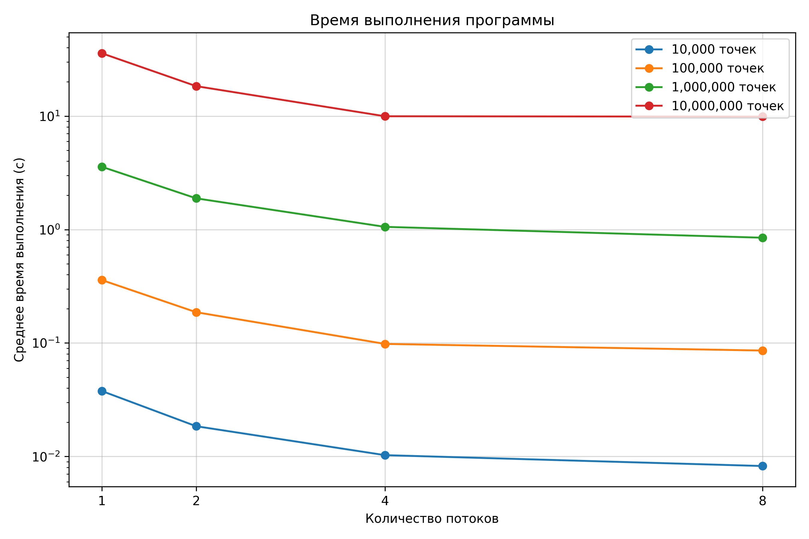
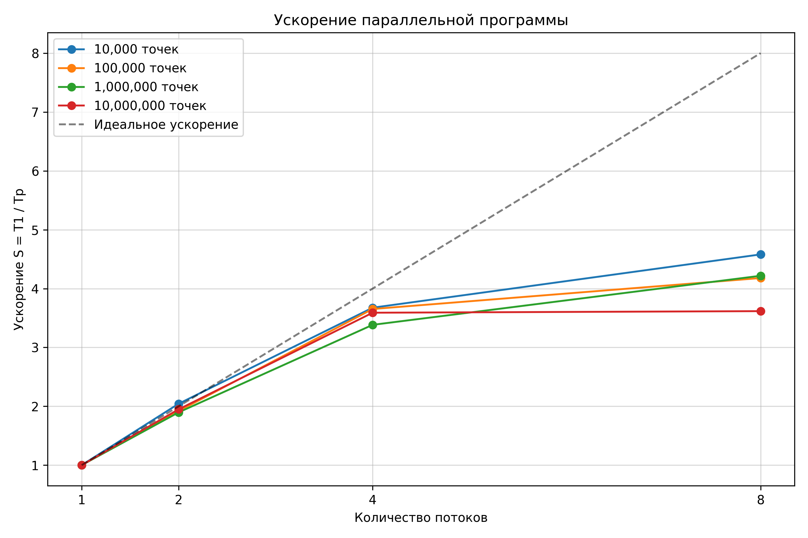
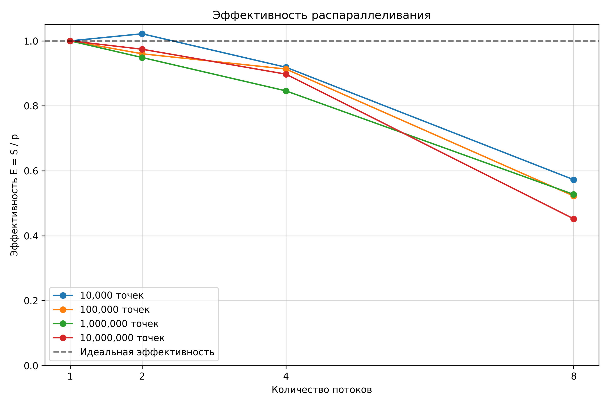

# Задание 1. Множество Мандельброта (2 балла)

## Постановка задачи

Разработать параллельную программу для нахождения заданного количества точек множества Мандельброта.

**Входные данные:** `./program nthreads npoints`, где `nthreads` — количество потоков, `npoints` — количество точек.

**Выходные данные:** CSV-файл с координатами найденных точек.

Множество Мандельброта определяется последовательностью:

$$
z_{n+1}=z_n^2+c,\quad z_0=0
$$

Число $c$ принадлежит множеству, если для всех $n$ выполняется условие $|z_n|<2$.

## Реализация

Программа написана на C с использованием библиотеки **Pthreads**. Алгоритм основан на случайной генерации точек и проверке их принадлежности множеству Мандельброта.

Каждый поток независимо генерирует координаты в области $x\in[-2;1]$, $y\in[-1;1]$ с помощью `rand_r()`, используя собственное состояние генератора случайных чисел.

Для каждой точки функция `is_in_mandelbrot()` вычисляет последовательность $z_{n+1}=z_n^2+c$, отдельно рассчитывая действительную и мнимую части:

```math
Re(z_{n+1}) = Re(z_n)^2 - Im(z_n)^2 + x
```

```math
Im(z_{n+1}) = 2Re(z_n)Im(z_n) + y
```

Если квадрат модуля комплексного числа достигает 4, точка отклоняется. Если за `MAX_ITER = 1000` итераций этого не происходит, точка принимается как принадлежащая множеству (приближённая проверка).

Для уменьшения затрат на синхронизацию используется **пакетная обработка** (`BATCH_SIZE = 100`). Каждый поток проверяет 100 кандидатов, сохраняет подходящие точки в локальный массив `local_points`, после чего записывает их в общий CSV-файл.

Доступ к общему счётчику `global_points_count`, флагу завершения `stop_flag` и запись в файл защищены мьютексом `pthread_mutex_t`. Когда количество записанных точек достигает `npoints`, устанавливается `stop_flag = 1`, после чего потоки завершают работу.

Потоки создаются через `pthread_create()`, а их завершение ожидается через `pthread_join()`. Результаты сохраняются в `csv_results/set_nthreads_npoints.csv`.

## Методика измерений

Измерения проводились на следующей аппаратной архитектуре:

| Характеристика | Значение |
|---|---|
| Процессор | Apple M3, 8 ядер |
| Архитектура | ARM64 |
| Оперативная память | 16 ГБ |
| ОС | macOS 26.5 |
| Компилятор | Apple Clang 17.0.0 (`-O2 -pthread`) |

Время измерялось с помощью `GET_TIME()` из `timer.h` от начала создания потоков до их завершения, включая вычисления, синхронизацию и запись координат в CSV.

Для каждой конфигурации выполнялось **10 запусков**, после чего вычислялось среднее арифметическое:

$$
T_{avg}=\frac{1}{10}\sum_{i=1}^{10}T_i
$$

## Результаты

**Среднее время выполнения (с):**

| Количество точек | 1 поток | 2 потока | 4 потока | 8 потоков |
|---|---:|---:|---:|---:|
| 10 000 | 0.0378 | 0.0185 | 0.0103 | 0.0082 |
| 100 000 | 0.3586 | 0.1867 | 0.0982 | 0.0858 |
| 1 000 000 | 3.5727 | 1.8829 | 1.0558 | 0.8470 |
| 10 000 000 | 35.7453 | 18.3444 | 9.9567 | 9.8833 |

Ускорение рассчитывалось как отношение среднего времени выполнения на одном потоке к среднему времени на $p$ потоках:

$$
S_p=\frac{T_1}{T_p}
$$

Эффективность распараллеливания:

$$
E_p=\frac{S_p}{p}
$$

**Ускорение для 10 млн точек:**

| Потоки | Ускорение |
|---|---:|
| 1 | 1.00 |
| 2 | 1.95 |
| 4 | 3.59 |
| 8 | 3.62 |

### Графики производительности

<p align="center">
  
  
  
</p>

## Вывод

Распараллеливание позволило сократить время поиска 10 млн точек с **35,75 до 9,88 с**, достигнув ускорения в **3,62 раза** при использовании 8 потоков.

Наибольший прирост производительности наблюдается при увеличении количества потоков до 4. При переходе с 4 на 8 потоков ускорение растёт незначительно, особенно для больших объёмов данных.

Эффективность распараллеливания снижается с увеличением числа потоков, что может быть связано с затратами на синхронизацию, последовательной записью результатов в CSV и особенностями архитектуры процессора.

Пакетная обработка по 100 кандидатов уменьшает частоту захвата мьютекса и снижает накладные расходы на синхронизацию.
